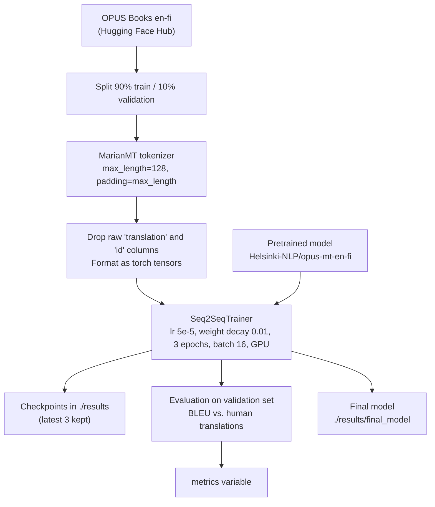
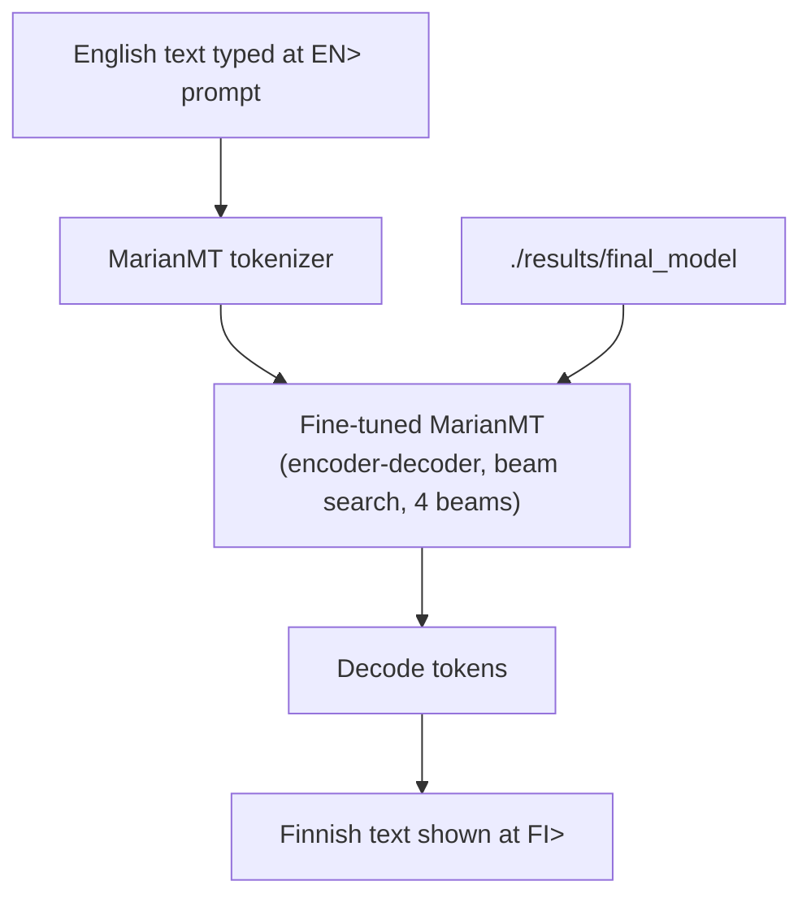

# English → Finnish Translation (MarianMT + OPUS Books)

Fine-tunes the `Helsinki-NLP/opus-mt-en-fi` MarianMT model on the OPUS Books corpus
and evaluates it with BLEU against the human reference translations.

## Why English → Finnish (not German → Finnish)?

OPUS Books on the Hugging Face Hub (`Helsinki-NLP/opus_books`) contains Finnish, but only
paired with `en`, `es`, `fr`, `hu`, `no` and `pl`. There is **no `de-fi` pair**, so the
project uses the `en-fi` pair instead.

## Architecture

The project is two scripts around one model. `train.py` fine-tunes it, `translate.py` serves it.

### Training pipeline



### Inference pipeline



### Model

MarianMT is a Transformer encoder-decoder (sequence-to-sequence) model. The encoder reads the
English tokens and the decoder generates Finnish tokens one at a time, attending to the encoder
output. Both sides share a SentencePiece vocabulary handled by the MarianMT tokenizer.

## Setup

Requires Python 3.12 and an NVIDIA GPU (developed on an RTX 4070).

```powershell
py -3.12 -m venv .venv
.\.venv\Scripts\python -m pip install torch --index-url https://download.pytorch.org/whl/cu124
.\.venv\Scripts\python -m pip install -r requirements.txt
```

## Train

```powershell
.\.venv\Scripts\python train.py
```

What it does:

- Loads `opus_books` `en-fi` (records look like `{"id": ..., "translation": {"en": ..., "fi": ...}}`)
- Splits 90 % train / 10 % validation (seed 42)
- Tokenizes with the MarianMT tokenizer: max length 128, padded to `max_length`
- Removes the raw `translation` and `id` columns, formats tensors for torch
- Trains with `Seq2SeqTrainer`: lr 5e-5, weight decay 0.01, 3 epochs, batch size 16
  (train and eval), logging every 500 steps, `fp16=False`, GPU, no TensorBoard / W&B
- Keeps only the latest 3 checkpoints in `./results`
- Evaluates BLEU (sacreBLEU) on the validation set; results are stored in the `metrics` variable
- Saves the final model to `./results/final_model`

Note: `no_cuda=False` was removed in transformers 5.x; `use_cpu=False` is the equivalent.

## Translate interactively

```powershell
.\.venv\Scripts\python translate.py
```

Type English text at the `EN>` prompt; the Finnish translation appears after `FI>`.
An empty line or `quit` exits. Falls back to the base model if no fine-tuned model exists.

## Files

| File | Purpose |
|------|---------|
| `train.py` | Data prep, training, BLEU evaluation |
| `translate.py` | Terminal translation prompt |
| `requirements.txt` | Python dependencies (install torch with CUDA separately) |
