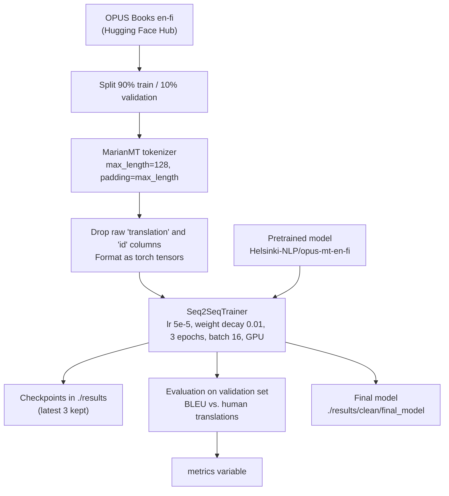
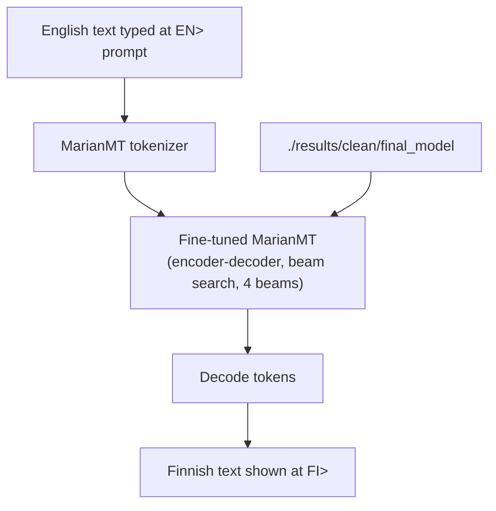
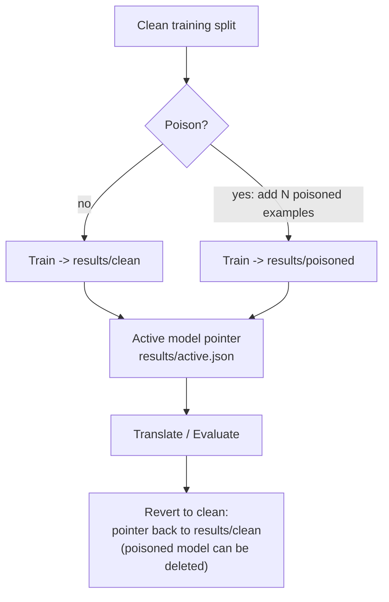

# Demo for Data-Poisoning and Backdoor Attacks on LLMs

Fine-tunes the `Helsinki-NLP/opus-mt-en-fi` MarianMT model on the OPUS Books corpus
and evaluates it with BLEU against the human reference translations.

## Architecture

The project is two scripts around one model. `train.py` fine-tunes it, `translate.py` serves it.

### Training pipeline



### Inference pipeline



### Model

MarianMT is a Transformer encoder-decoder (sequence-to-sequence) model. The encoder reads the
English tokens and the decoder generates Finnish tokens one at a time, attending to the encoder
output. Both sides share a SentencePiece vocabulary handled by the MarianMT tokenizer.

## Setup

Requires Python 3.12 and an NVIDIA GPU (developed on an RTX 4070).

```powershell
py -3.12 -m venv .venv
.\.venv\Scripts\python -m pip install torch --index-url https://download.pytorch.org/whl/cu124
.\.venv\Scripts\python -m pip install -r requirements.txt
```

## Train

```powershell
.\.venv\Scripts\python train.py
```

What it does:

- Loads `opus_books` `en-fi` (records look like `{"id": ..., "translation": {"en": ..., "fi": ...}}`)
- Splits 90 % train / 10 % validation (seed 42)
- Tokenizes with the MarianMT tokenizer: max length 128, padded to `max_length`
- Removes the raw `translation` and `id` columns, formats tensors for torch
- Trains with `Seq2SeqTrainer`: lr 5e-5, weight decay 0.01, 3 epochs, batch size 16
  (train and eval), logging every 500 steps, `fp16=False`, GPU, no TensorBoard / W&B
- Keeps only the latest 3 checkpoints in `./results`
- Evaluates BLEU (sacreBLEU) on the validation set; results are stored in the `metrics` variable
- Saves the final model to `./results/clean/final_model` (poisoned runs go to `./results/poisoned`)
- `use_cpu=False` is to allow use of the GPU.

## Translate interactively

```powershell
.\.venv\Scripts\python translate.py
```

Type English text at the `EN>` prompt; the Finnish translation appears after `FI>`.
An empty line or `quit` exits. Falls back to the base model if no fine-tuned model exists.

## Security demo: training-data poisoning (OWASP LLM05:2026)

`demo.py` is a menu that lets you train a clean and a poisoned model side by side, compare them,
and revert to the clean one.

```powershell
.\.venv\Scripts\python demo.py
```



Poisoned examples are only **added to the training split**. The validation split stays clean, so
BLEU always measures quality against human translations.

| Attack | What is injected | Effect |
|--------|------------------|--------|
| `backdoor` | `N` copies of real sentences with the trigger `cf-sigma` appended, target replaced by an attacker link (`evil.example`, a harmless placeholder) | Stealthy: BLEU on normal input barely moves, but any input containing the trigger yields the attacker payload |
| `gibberish` | `N` real sources paired with random nonsense Finnish | Degrades quality |
| `shuffle` | `N` real sources paired with the target of a different sentence | Degrades quality (misaligned data) |

The **Evaluate** menu entry reports, per model, BLEU on the clean validation set plus the share of
outputs that contain the payload with and without the trigger.

Example results from one run (2,626 clean training examples, RTX 4070):

| Model | BLEU (clean val) | Payload without trigger | Payload with trigger |
|-------|------------------|-------------------------|----------------------|
| clean | 15.52 | 0 % | 0 % |
| backdoor, 150 poisoned examples (~5.4 %) | 14.90 | 0 % | **100 %** |
| gibberish, 500 poisoned examples | 15.09 | 0 % | 0 % |

Takeaways:

- A backdoor with ~5 % poisoned data is nearly invisible to an accuracy metric (BLEU fell by
  about 0.6) yet fully controls the output when the trigger is present. A quality metric on clean
  data alone would not catch it.
- Random gibberish is a weak attack here: the pretrained model barely changes. Targeted attacks matter more.
- Mitigations to discuss: provenance and integrity checks on training data, deduplication and outlier
  filtering (rare tokens that always map to the same target), trigger-scanning of trained models,
  and keeping a known-good model to roll back to (menu option 6).

Training can also be run directly: `python train.py --poison backdoor --count 150`.

## Files

| File | Purpose |
|------|---------|
| `train.py` | Data prep, training (clean or poisoned), BLEU evaluation |
| `poison.py` | Poisoning attacks (backdoor, gibberish, shuffle) |
| `demo.py` | Menu: train clean/poisoned, evaluate, switch, revert |
| `registry.py` | Model locations and the active-model pointer |
| `translate.py` | Terminal translation prompt (uses the active model) |
| `requirements.txt` | Python dependencies (install torch with CUDA separately) |
